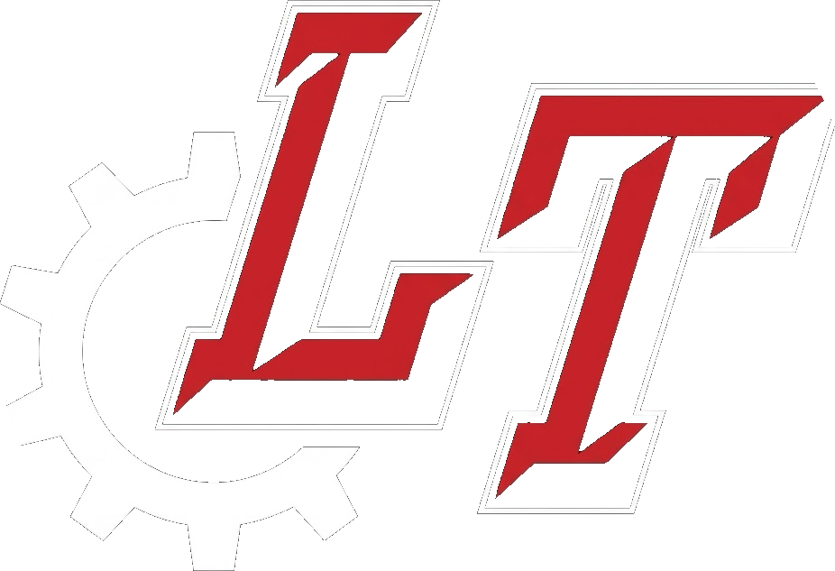
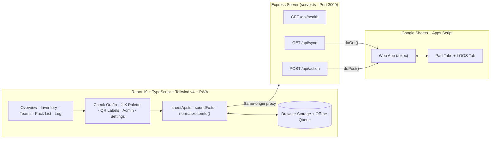

<div align="center">



# VEX Robotics Team 654 — Parts Inventory

**Fast part checkout, team kit checks, printable QR bin labels, and offline-ready pit tools for Lake Travis VEX Robotics (Club 654).**

[](.github/workflows/ci.yml)
[](.github/workflows/codeql.yml)
[](https://react.dev/)
[](https://www.typescriptlang.org/)
[](https://vite.dev/)
[](vite.config.ts)
[](LICENSE)

[Overview](#overview) · [Features](#features) · [Shortcuts](#keyboard-shortcuts) · [Architecture](docs/ARCHITECTURE.md) · [Google Sheets Setup](docs/GOOGLE_SHEETS_SETUP.md) · [VEX Parts](#supported-vex-v5-parts) · [Setup](#getting-started)

</div>

---

## Overview

Built for daily shop use and tournament pits, this app replaces manual spreadsheet edits with a fast **red, black, and white** inventory tracker for every **Club 654** team (`654K`, `654J`, `654A`, `654B`, `654G`, `654T`, `654V`, `654Y`, `654X`, `654Z`, `654W`, and `RECF`).

Students can check parts in and out in seconds from a laptop, phone, or installed PWA, while coaches and leads get a live Pit Stock Health overview, per-team Core Kit checks, printable QR bin labels, part repair tracking, tournament pack checklists, and non-destructive Google Sheets syncing.

```text
+-----------------------------------------------------------------------------+
|                        VEX ROBOTICS CLUB 654 STORAGE                        |
|                                                                             |
|  CABINET 1               PNEUMATICS CABINET       SENSOR CABINET            |
|  · V5 Brains (VEXB)      · Solenoids (VEXSOL)     · Optical (VEXS-O)        |
|  · V5 Radios (VEXR)                               · Distance (VEXS-DIST)    |
|                                                   · Inertial (VEXS-INER)    |
|                                                   · Rotational (VEXS-ROT)   |
+-----------------------------------------------------------------------------+
```

---

## Features

### Quick Check Out, Check In & Batch Queue
- **Two Input Modes**: Pick parts via **Type + Part #** stepper or search the full catalog directly inside `CheckInOutModal`.
- **Multi-Part Batch Queue**: Queue multiple parts across both input modes and submit them together in a single batch.
- **Smart ID Matching**: Typing `sol 1`, `4`, `DIST-4`, `VEX-DIST-004`, `brain #2`, or `opt3` automatically resolves to the canonical ID (`VEXSOL-1`, `VEXS-DIST-4`, `VEXB-2`, `VEXS-O-3`).
- **Student Email Validation + Admin Mode**: Students enter a school email when borrowing or returning parts. Coaches and leads sign into **Admin Mode** (PIN or allowlisted email) for 1-click returns, bulk edits, repair controls, and settings changes.
- **1-Tap Undo**: Revert recent checkouts or returns straight from the confirmation toast notification.

### Five Focused Views & Command Palette
| View | What It Does |
|:---|:---|
| **Overview** | Live Pit Stock Health ratio bar, category breakdown, 14+ day overdue review, cabinet locator, quick borrow shortcuts, and QR Labels trigger. |
| **Parts Inventory** | Search all 179 starter parts, step through items (`←`/`→`) in the Part Details drawer, toggle `Needs Repair` flags, copy rows to clipboard (`Copy Rows`), or export CSV. |
| **Team Parts** | Filter everything checked out to a specific team (`654K`–`654W` + `RECF`), check core kit coverage (`Brain`, `Radio`, `Sensors`, `Solenoids`) with 1-tap assignment, print checklists, or batch-return parts. |
| **Pack List** | Search and filter tournament pit box spares against live available stock, add custom spare items, and track 100% tournament readiness. |
| **Activity Log** | Progressive-loaded history of every checkout and return filtered by team, action, or email, with CSV export. |

- **Command Palette (`⌘K` / `Ctrl+K`)**: Jump directly to any view, club team, part ID, sync action, QR label sheet, or diagnostics screen from anywhere.

### Pit & Shop Utilities
- **Printable QR Bin Labels (`LabelPrinterModal`)**: Pick specific parts or categories and print 3-column or 4-column sticker sheets with QR codes, part IDs, and cabinet locations.
- **Part Health & Repair Flags**: Flag damaged hardware as `Needs Repair` from the Parts Inventory, Mobile Cards, or Check In sheet, with checkout warnings before parts go back on a robot.
- **Offline Sync Queue & PWA (`PWAControls`)**: Installable on iOS, Android, and Desktop. Actions submitted without venue Wi-Fi save to a local offline queue and sync automatically when Wi-Fi returns.
- **Adaptive Desktop & Phone Layout**: Automatically switches to `MobileTopHeader`, `MobileBottomNav`, swipe-friendly `MobileInventoryList` cards, responsive bottom sheets, and a floating Back-to-Top button—plus a manual **Phone View / Desktop View** toggle.
- **Clean Print Sheets (`P` / `Ctrl+P`) & Sound Effects (`M`)**: High-contrast black-and-white `@media print` stylesheets and optional Web Audio cues respecting `prefers-reduced-motion`.

---

## Keyboard Shortcuts

| Key | Action | What It Opens |
|:---:|:---|:---|
| `1` | **Overview** | Main dashboard and quick finder |
| `2` | **Parts Inventory** | Full searchable parts table |
| `3` | **Team Parts** | Parts checked out by team |
| `4` | **Pack List** | Competition pit box checklist |
| `5` | **Activity Log** | Checkout and return history |
| `/` or `⌘K` | **Search / Palette** | Focus search or open Command Palette (`⌘K`) |
| `←` / `→` | **Step Parts** | Previous / Next part inside the Part Details drawer |
| `C` | **Check Out / In** | Open the Check Out / Check In sheet |
| `D` | **App Status** | Cache size, sync check, offline queue, and server ping |
| `M` | **Sound** | Toggle click and confirmation sounds |
| `P` | **Print** | Print current inventory sheet (`Ctrl+P`) |
| `?` | **Shortcuts** | Open shortcuts help window |
| `Esc` | **Close** | Close open modals, drawers, or clear focus |

---

## Architecture & Google Sheets Sync



- **Full Architecture Reference**: [`docs/ARCHITECTURE.md`](docs/ARCHITECTURE.md)
- **Google Sheets & Apps Script Setup Guide**: [`docs/GOOGLE_SHEETS_SETUP.md`](docs/GOOGLE_SHEETS_SETUP.md)

---

## Supported VEX V5 Parts

| Category | ID Prefix | VEX Part # | Interface | Operating Spec | Manual Rule | Storage |
|:---|:---:|:---:|:---|:---|:---:|:---|
| **V5 Brain** | `VEXB-*` | `276-4810` | Dual Cortex-A9 / VEXos / 21 Smart Ports | 7.2V – 12.8V Smart Battery | `<R11>` Max 1 per robot | Cabinet 1 |
| **V5 Radio** | `VEXR-*` | `276-4831` | 2.4 GHz DSSS / VEXnet 3.0 / BLE 4.2 | 16 RF channels | `<R11>` Clear line of sight | Cabinet 1 |
| **Optical Sensor** | `VEXS-O-*` | `276-4833` | V5 Smart Port (RS-485) | 10 mm – 100 mm, 100 Hz | `<R13>` Legal Smart sensor | Sensor Cabinet |
| **Distance Sensor** | `VEXS-DIST-*` | `276-4834` | V5 Smart Port (Class 1 Laser) | 20 mm – 2,000 mm | `<R13>` Class 1 IEC 60825-1 | Sensor Cabinet |
| **Inertial Sensor** | `VEXS-INER-*` | `276-4840` | V5 Smart Port (6-DOF IMU) | +/-2,000 deg/s, +/-8G | `<R13>` Flat rigid mount | Sensor Cabinet |
| **Rotational Sensor** | `VEXS-ROT-*` | `276-6010` | V5 Smart Port (Magnetic) | 360 deg, 4,096 ticks/rev | `<R13>` Tracking pods | Sensor Cabinet |
| **Pneumatic Solenoid** | `VEXSOL-*` | `276-8140` | V5 3-Wire / PCM (5V DC) | 0 – 100 PSI, 12ms shift | `<R12>` Max 100 PSI | Pneumatics Cabinet |

---

## Getting Started

### Requirements
- [Bun](https://bun.sh/) *(recommended, `bun.lock` included)* or **Node.js 22+** (`.nvmrc` included)
- Any modern browser

### Run Locally

```bash
# 1. Clone the repository
git clone https://github.com/your-organization/vex-robotics-inventory.git
cd vex-robotics-inventory

# 2. Install packages
bun install
# or: npm install

# 3. Start Express + Vite on http://localhost:3000
bun run dev
# or: npm run dev
```

### Scripts

| Command | What It Runs |
|:---|:---|
| `bun run dev` | Full-stack Express + Vite server on port `3000` |
| `bun run lint` | TypeScript check (`tsc --noEmit`) |
| `bun run test` | Verification suite (`scripts/verify.ts`: ID parser, storage, SSR views, proxy/theme/dialog guardrails) |
| `bun run build` | Production Vite + PWA bundle into `dist/` |
| `bun run start` | Production Express server on port `3000` |
| `bun run create:qr-badges` | Regenerates QR badge PNGs in `public/qr_badges/` |

---

## Project Structure

<details>
<summary><strong>Click to expand repository layout</strong></summary>

```text
.
├── .github/
│   ├── ISSUE_TEMPLATE/
│   │   ├── bug_report.yml            # Structured bug report form
│   │   ├── feature_request.yml       # Feature proposal form
│   │   ├── part_catalog_update.yml   # Part catalog / team roster change request
│   │   └── config.yml                # Issue chooser configuration
│   ├── workflows/
│   │   ├── ci.yml                    # Type-check, SSR/guardrail tests, PWA build & smoke test
│   │   ├── codeql.yml                # Scheduled & PR TypeScript/JavaScript security scan
│   │   ├── pr-labeler.yml            # Auto-labels PRs by changed directory
│   │   └── release.yml               # Builds, packages, and publishes GitHub Releases on v* tags
│   ├── dependabot.yml                # Grouped weekly npm & GitHub Actions updates
│   ├── labeler.yml                   # Path matching rules for PR labels
│   ├── pull_request_template.md      # Pre-merge engineering checklist
│   └── release.yml                   # Categorized release notes configuration
├── docs/
│   ├── ARCHITECTURE.md               # Client/server data flow, ID parsing & storage reference
│   └── GOOGLE_SHEETS_SETUP.md        # Step-by-step Apps Script & LOGS sync guide
├── public/                           # Club logos, PWA icons, favicon.ico & QR badges
├── scripts/
│   └── verify.ts                     # Unit, SSR, JSON, proxy SSRF & theme guardrail suite
├── src/
│   ├── components/                   # 20 modular React UI views, drawers & modals
│   ├── data/                         # 179-part baseline catalog & VEX V5 hardware specs
│   ├── hooks/                        # useOnlineStatus & usePWAInstall hooks
│   ├── services/                     # sheetApi proxy client & Web Audio soundFx
│   ├── App.tsx                       # Root state, shortcuts, undo & desktop/mobile switcher
│   ├── index.css                     # Tailwind v4 theme, animations & print styles
│   ├── main.tsx                      # React 19 entry point
│   └── types.ts                      # Shared types, ID normalizer & category classifiers
├── .editorconfig                     # Unified UTF-8, LF & 2-space indent rules
├── .gitattributes                    # Cross-platform line-ending & binary asset protection
├── .nvmrc                            # Node.js 22 runtime pin
├── CHANGELOG.md                      # Version release notes
├── CODE_OF_CONDUCT.md                # Club 654 collaboration standards
├── CONTRIBUTING.md                   # Development & style guidelines
├── SECURITY.md                       # Proxy SSRF rules & vulnerability reporting policy
├── LICENSE                           # MIT License
├── create_qr_badges.mjs              # QR badge image generator script
├── server.ts                         # Express proxy + Vite/static server (port 3000)
└── vite.config.ts                    # Vite 8 + Tailwind v4 + PWA configuration
```

</details>

---

## Contributing, Code of Conduct & Security

- **Contributing**: [`CONTRIBUTING.md`](CONTRIBUTING.md)
- **Code of Conduct**: [`CODE_OF_CONDUCT.md`](CODE_OF_CONDUCT.md)
- **Changelog**: [`CHANGELOG.md`](CHANGELOG.md)
- **Security Policy**: [`SECURITY.md`](SECURITY.md)

---

## Credits & License

Built by **Trishanth Yakkala** for **VEX Robotics Team 654**.  
Released under the [MIT License](LICENSE).
