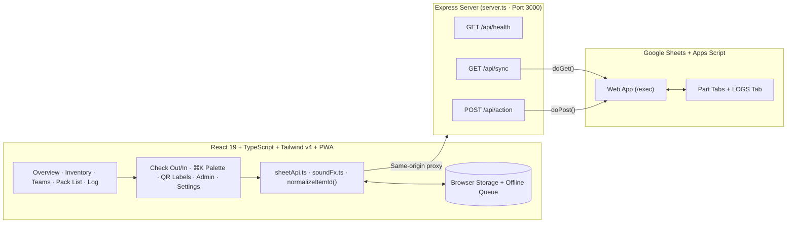

<div align="center">


# VEX Robotics Team 654 — Parts Inventory

**Fast part checkout, team equipment tracking, printable QR bin labels, and offline-ready pit tools for Lake Travis VEX Robotics (Club 654).**

[](.github/workflows/ci.yml)
[](https://react.dev/)
[](https://www.typescriptlang.org/)
[](https://vite.dev/)
[](https://tailwindcss.com/)
[](vite.config.ts)
[](LICENSE)

[Overview](#overview) · [Features](#features) · [Shortcuts](#keyboard-shortcuts) · [Architecture](#how-it-works) · [VEX Parts](#supported-vex-v5-parts) · [Setup](#getting-started) · [Google Sheets](#google-sheets-sync)

</div>

---

## Overview

Built for daily shop use and tournament pits, this app replaces manual spreadsheet edits with a fast **red, black, and white** inventory tracker for every **Club 654** team (`654K`, `654J`, `654A`, `654B`, `654G`, `654T`, `654V`, `654Y`, `654X`, `654Z`, `654W`, and `RECF`).

Students can check parts in and out in seconds from a laptop, phone, or installed PWA, while coaches and leads get per-team custody breakdowns, printable QR bin labels, part health tracking, tournament pack lists, and non-destructive Google Sheets syncing.

```text
+-----------------------------------------------------------------------------+
|                        VEX ROBOTICS CLUB 654 STORAGE                        |
|                                                                             |
|  CABINET 1               PNEUMATICS CABINET       SENSOR CABINET            |
|  · V5 Brains (VEXB)      · Solenoids (VEXSOL)     · Optical (VEXS-O)        |
|  · V5 Radios (VEXR)                               · Distance (VEXS-DIST)    |
|                                                   · Inertial (VEXS-INER)    |
|                                                   · Rotational (VEXS-ROT)   |
+-----------------------------------------------------------------------------+
```

---

## Features

### Quick Check Out, Check In & Batch Queue
- **Two Input Modes**: Pick parts via **Type + Part #** stepper or search the full catalog directly inside `CheckInOutModal`.
- **Multi-Part Batch Queue**: Queue multiple parts across both input modes and submit them together in a single batch.
- **Smart ID Matching**: Typing `sol 1`, `4`, `DIST-4`, `VEX-DIST-004`, `brain #2`, or `opt3` automatically resolves to the canonical ID (`VEXSOL-1`, `VEXS-DIST-4`, `VEXB-2`, `VEXS-O-3`).
- **Student Email Validation + Admin Mode**: Students enter a school email when borrowing or returning parts. Coaches and leads sign into **Admin Mode** (PIN or allowlisted email) for 1-click returns, bulk edits, repair controls, and settings changes.
- **1-Tap Undo**: Revert recent checkouts or returns straight from the confirmation toast notification.

### Five Focused Views & Command Palette
| View | What It Does |
|:---|:---|
| **Overview** | Live stock totals, category breakdown, cabinet locator, quick borrow shortcuts, overdue checkouts, and recent activity. |
| **Parts Inventory** | Search all 179 starter parts (plus synced sheet parts), inspect specs & custody history in a slide-over drawer, toggle `Needs Repair` health flags, and export CSV. |
| **Team Parts** | Filter everything checked out to a specific team (`654K`–`654W` + `RECF`), print a team checklist, or return parts in one batch. |
| **Pack List** | Track tournament pit box spares against live available stock, add custom spare items, and catch low-stock warnings early. |
| **Activity Log** | Progressive-loaded history of every checkout and return filtered by team, action, or email, with CSV export. |

- **Command Palette (`⌘K` / `Ctrl+K`)**: Jump directly to any view, club team, part ID, sync action, QR label sheet, or diagnostics screen from anywhere.

### Pit & Shop Utilities
- **Printable QR Bin Labels (`LabelPrinterModal`)**: Pick specific parts or categories and print 3-column or 4-column sticker sheets with QR codes, part IDs, and cabinet locations. Selections persist safely while searching or syncing.
- **Part Health & Repair Flags**: Flag damaged hardware as `Needs Repair` from the Parts Inventory, Mobile Cards, or Check In sheet, triggering clear checkout warnings before parts go back on a robot.
- **Offline Sync Queue & PWA (`PWAControls`)**: Installable on mobile and desktop. Actions submitted without venue Wi-Fi are stored in an offline queue and synced automatically once connection returns.
- **Built for Desktop and Phone**: Automatically switches to `MobileTopHeader`, `MobileBottomNav`, swipe-friendly `MobileInventoryList` cards, and bottom-sheet modals with safe-area padding—plus a manual **Phone View / Desktop View** toggle.
- **Clean Print Sheets (`P` / `Ctrl+P`) & Sound Effects (`M`)**: High-contrast black-and-white `@media print` stylesheets and optional Web Audio confirmation sounds respecting `prefers-reduced-motion`.

---

## Keyboard Shortcuts

| Key | Action | What It Opens |
|:---:|:---|:---|
| `1` | **Overview** | Main dashboard and quick finder |
| `2` | **Parts Inventory** | Full searchable parts table |
| `3` | **Team Parts** | Parts checked out by team |
| `4` | **Pack List** | Competition pit box checklist |
| `5` | **Activity Log** | Checkout and return history |
| `/` or `⌘K` | **Search / Palette** | Focus search or open Command Palette (`⌘K`) |
| `C` | **Check Out / In** | Open the Check Out / Check In sheet |
| `D` | **App Status** | Cache size, sync check, offline queue, and server ping |
| `M` | **Sound** | Toggle click and confirmation sounds |
| `P` | **Print** | Print current inventory sheet (`Ctrl+P`) |
| `?` | **Shortcuts** | Open shortcuts help window |
| `Esc` | **Close** | Close open modals, drawers, or clear focus |

---

## How It Works



- **Safe Proxy**: `server.ts` validates Google Apps Script URLs with `new URL()`, enforces `https://`, blocks loopback and private network ranges, and only forwards requests to `script.google.com` or `script.googleusercontent.com`.
- **Resilient Local State**: Works offline out of the box with local caching, explicit disconnect persistence, sanitized sheet parsing, and corrupted-storage recovery.

---

## Supported VEX V5 Parts

| Category | ID Prefix | VEX Part # | Interface | Operating Spec | Manual Rule | Storage |
|:---|:---:|:---:|:---|:---|:---:|:---|
| **V5 Brain** | `VEXB-*` | `276-4810` | Dual Cortex-A9 / VEXos / 21 Smart Ports | 7.2V – 12.8V Smart Battery | `<R11>` Max 1 per robot | Cabinet 1 |
| **V5 Radio** | `VEXR-*` | `276-4831` | 2.4 GHz DSSS / VEXnet 3.0 / BLE 4.2 | 16 RF channels | `<R11>` Clear line of sight | Cabinet 1 |
| **Optical Sensor** | `VEXS-O-*` | `276-4833` | V5 Smart Port (RS-485) | 10 mm – 100 mm, 100 Hz | `<R13>` Legal Smart sensor | Sensor Cabinet |
| **Distance Sensor** | `VEXS-DIST-*` | `276-4834` | V5 Smart Port (Class 1 Laser) | 20 mm – 2,000 mm | `<R13>` Class 1 IEC 60825-1 | Sensor Cabinet |
| **Inertial Sensor** | `VEXS-INER-*` | `276-4840` | V5 Smart Port (6-DOF IMU) | +/-2,000 deg/s, +/-8G | `<R13>` Flat rigid mount | Sensor Cabinet |
| **Rotational Sensor** | `VEXS-ROT-*` | `276-6010` | V5 Smart Port (Magnetic) | 360 deg, 4,096 ticks/rev | `<R13>` Tracking pods | Sensor Cabinet |
| **Pneumatic Solenoid** | `VEXSOL-*` | `276-8140` | V5 3-Wire / PCM (5V DC) | 0 – 100 PSI, 12ms shift | `<R12>` Max 100 PSI | Pneumatics Cabinet |

---

## Getting Started

### Requirements
- [Bun](https://bun.sh/) *(recommended, `bun.lock` included)* or **Node.js 20+**
- Any modern browser

### Run Locally

```bash
# 1. Clone the repository
git clone https://github.com/your-organization/vex-robotics-inventory.git
cd vex-robotics-inventory

# 2. Install packages
bun install
# or: npm install

# 3. Start Express + Vite on http://localhost:3000
bun run dev
# or: npm run dev
```

### Scripts

| Command | What It Runs |
|:---|:---|
| `bun run dev` | Full-stack Express + Vite server on port `3000` |
| `bun run lint` | TypeScript check (`tsc --noEmit`) |
| `bun run test` | Automated verification (`scripts/verify.ts`: ID parser, storage, SSR views, asset/theme checks) |
| `bun run build` | Production Vite + PWA bundle into `dist/` |
| `bun run start` | Production Express server on port `3000` |
| `bun run create:qr-badges` | Regenerates QR badge PNGs in `public/qr_badges/` |

---

## Google Sheets Sync

When connected to Google Sheets, the app uses a **LOGS-only** setup so formula-driven hardware tabs are never overwritten:

- **`doGet(e)`**: Reads your hardware tabs (`OPTICAL`, `DISTANCE`, `INERTIAL`, `ROTATIONAL`, `SOLENOIDS`, `RADIO`, `BRAIN`) and `LOGS` tab.
- **`doPost(e)`**: Appends a single row to `LOGS` (`Timestamp`, `Item ID`, `Action`, `Team`, `Notes`, `Borrower Email`, `Category`, `Number`).

<details>
<summary><strong>Step-by-step Google Apps Script setup &amp; API endpoints</strong></summary>

1. Open your club Google Sheet and go to **Extensions > Apps Script**.
2. In the web app, sign into **Admin Mode**, open **Settings > Backend Code**, and copy the `Code.gs` script.
3. Click **Deploy > New deployment > Web app**:
   - **Execute as**: `Me`
   - **Who has access**: `Anyone`
4. Paste the `/exec` URL into **Settings > API Endpoint** and click **Connect & Sync**.

| Endpoint | Method | Purpose |
|:---|:---:|:---|
| `/api/health` | `GET` | Health & ping check (`{ status: "ok", timestamp }`) |
| `/api/sync` | `GET` | Fetches and sanitizes inventory & log rows from `?url=<GAS_EXEC_URL>` |
| `/api/action` | `POST` | Validates and posts a checkout/return row to Google Apps Script |

</details>

---

## Project Structure

<details>
<summary><strong>Click to expand repository layout</strong></summary>

```text
.
├── .github/
│   ├── ISSUE_TEMPLATE/
│   │   ├── bug_report.yml            # Structured bug report form
│   │   ├── feature_request.yml       # Feature proposal form
│   │   └── config.yml                # Issue chooser configuration
│   ├── workflows/
│   │   └── ci.yml                    # TypeScript check, verify suite, build & server check
│   ├── dependabot.yml                # Grouped weekly npm & GitHub Actions updates
│   ├── pull_request_template.md      # Pre-merge engineering checklist
│   └── release.yml                   # Categorized release notes configuration
├── public/                           # Club logos, PWA icons, favicon.ico, and QR badges
├── scripts/
│   └── verify.ts                     # Unit, SSR, storage, asset, and theme guardrail checks
├── src/
│   ├── components/
│   │   ├── ActivityLogs.tsx          # Paginated checkout/return history + CSV export
│   │   ├── AdminUnlockModal.tsx      # PIN / email admin sign-in modal
│   │   ├── CheckInOutModal.tsx       # Dual-mode Check Out / Check In + Batch Queue sheet
│   │   ├── ClubAssetsModal.tsx       # Club logos & QR badge downloads
│   │   ├── CommandCenter.tsx         # Overview dashboard, quick finder & drilldowns
│   │   ├── CommandPalette.tsx        # ⌘K quick navigation & action launcher
│   │   ├── CompetitionPackList.tsx   # Pit box packing list & low-stock alerts
│   │   ├── Header.tsx                # Desktop header navigation & quick tools
│   │   ├── InventoryBrowser.tsx      # Paginated desktop table, inspector drawer & bulk actions
│   │   ├── KeyboardShortcutsModal.tsx # Keyboard shortcuts reference modal
│   │   ├── LabelPrinterModal.tsx     # Printable 3-col / 4-col QR bin label sheet generator
│   │   ├── MobileBottomNav.tsx       # Mobile bottom navigation bar
│   │   ├── MobileInventoryList.tsx   # Mobile expandable part cards with quick actions
│   │   ├── MobileTopHeader.tsx       # Compact mobile header & navigation drawer
│   │   ├── MotionPrimitives.tsx      # Spring pill tabs, spotlight cards & gauges
│   │   ├── PWAControls.tsx           # Offline queue banner & app install prompt
│   │   ├── SettingsModal.tsx         # Google Sheet URL, admin PIN/emails & Code.gs
│   │   ├── SystemDiagnosticsModal.tsx # App status, cache usage, offline queue & connection test
│   │   ├── TeamLookup.tsx            # Per-team parts breakdown & batch returns
│   │   └── Toast.tsx                 # Toast notifications with 1-tap Undo
│   ├── data/
│   │   ├── mockInventory.ts          # Starter 179-part inventory & default pack list
│   │   └── vexSpecs.ts               # VEX V5 part specs & manual rules
│   ├── hooks/
│   │   ├── useOnlineStatus.ts        # Online/offline connectivity & queued action count hook
│   │   └── usePWAInstall.ts          # Browser / mobile PWA install prompt hook
│   ├── services/
│   │   ├── sheetApi.ts               # Proxy/direct Google Sheets client, offline queue & Code.gs
│   │   └── soundFx.ts                # Web Audio sound effects
│   ├── App.tsx                       # Root state, shortcuts, undo & desktop/mobile switcher
│   ├── index.css                     # Tailwind v4 theme, animations & print styles
│   ├── main.tsx                      # React 19 entry point
│   └── types.ts                      # Shared types, ID normalizer & category classifiers
├── CHANGELOG.md                      # Version release notes
├── CONTRIBUTING.md                   # Development & style guidelines
├── SECURITY.md                       # Security notes & reporting policy
├── LICENSE                           # MIT License
├── create_qr_badges.mjs              # QR badge image generator script
├── server.ts                         # Express proxy + Vite/static server (port 3000)
└── vite.config.ts                    # Vite 8 + Tailwind v4 + PWA configuration
```

</details>

---

## Contributing, Releases & Security

- **Contributing**: See [`CONTRIBUTING.md`](CONTRIBUTING.md) for code style, color tokens, ID rules, and verification commands.
- **Changelog**: See [`CHANGELOG.md`](CHANGELOG.md) for release history and notable fixes.
- **Security**: See [`SECURITY.md`](SECURITY.md) for proxy URL rules, admin boundaries, and vulnerability reporting.

---

## Credits & License

Built by **Trishanth Yakkala** for **VEX Robotics Team 654**.  
Released under the [MIT License](LICENSE).
