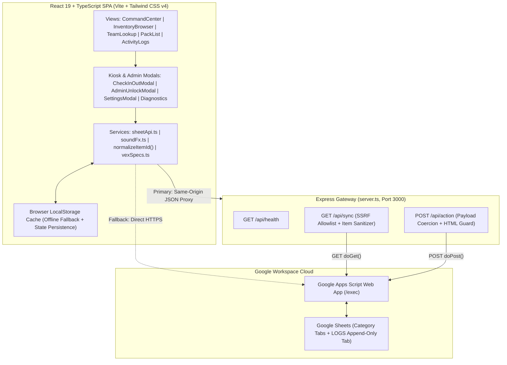

<div align="center">


# VEX Robotics Inventory Control

**Real-time fleet telemetry, hardware custody tracking, and competition pit logistics for VEX Robotics Club 654.**

[](https://react.dev/)
[](https://www.typescriptlang.org/)
[](https://vite.dev/)
[](https://tailwindcss.com/)
[](https://expressjs.com/)
[](https://www.vexrobotics.com/)
[](LICENSE)

[Overview](#overview) · [Capabilities](#key-capabilities) · [Architecture](#system-architecture) · [Hardware Specs](#supported-vex-hardware-telemetry) · [Quick Start](#getting-started) · [Sheets Sync](#google-sheets-logs-only-integration) · [API Reference](#api-reference)

</div>

---

## Overview

Engineered for high-tempo competition pit operations, **VEX Robotics Inventory Control** replaces manual spreadsheet edits, untracked sensor swaps, and tournament check-in bottlenecks with an industrial-grade, low-latency hardware custody command center.

Built around the **VEX V5 ecosystem** for Club 654 rosters (`654K`, `654J`, `654A`, `654B`, `654G`, `654T`, `654V`, `654Y`, `654X`, `654Z`, `654W`, and `RECF`), the platform pairs an obsidian/amber tactical UI with an Express proxy gateway and a non-destructive Google Sheets `LOGS`-only synchronization architecture.

```
+----------------------------------------------------------------------------------+
|                    VEX ROBOTICS CLUB 654 - COMMAND CENTER                        |
|                                                                                  |
|   CABINET 1               PNEUMATICS CABINET        SENSOR CABINET               |
|   V5 Brains (VEXB)        Solenoids (VEXSOL)        Optical (VEXS-O)             |
|   V5 Radios (VEXR)                                  Distance (VEXS-DIST)         |
|                                                     Inertial (VEXS-INER)         |
|                                                     Rotational (VEXS-ROT)        |
+----------------------------------------------------------------------------------+
```

---

## Key Capabilities

### Rapid-Fire Borrower Kiosk & Smart ID Normalization
- **Guided Component Assembly**: Interactive Type + Part Number stepper alongside catalog search (`CheckInOutModal`) reduces checkout and return friction on pit laptops and phones.
- **Smart ID Normalization**: Automatically normalizes shorthand inputs such as `sol 1`, `4`, `DIST-4`, `VEX-DIST-004`, `brain #2`, or `opt3` into canonical IDs (`VEXSOL-1`, `VEXS-DIST-4`, `VEXB-2`, `VEXS-O-3`).
- **Role-Aware Accountability**: Regular club members require a valid borrower email address (`@ltisdschools.net` or school email) on checkouts and check-ins. When **Admin Mode** is unlocked via PIN or authorized coach email, admins can check out, check in, 1-click return, and batch-process equipment without needing to enter an email.

### Multi-View Pit Operations Suite
- **Command Center**: Real-time KPI cards, cabinet availability filters, 1-click fast kiosk borrow shortcuts, overdue/maintenance/readiness drilldowns, and live recent transaction stream.
- **Master Inventory Browser**: Instant search (`/` hotkey), category & team filtering, natural numeric sorting (`VEXS-DIST-2` before `VEXS-DIST-10`), bulk admin check-out/check-in, and CSV export.
- **Team Hardware Lookup**: Per-team equipment breakdown across all club rosters (`654K`–`654W` + `RECF`) with 1-click admin returns and tournament batch return.
- **Competition Pack List**: Persistent tournament flight-case checklist comparing target spare quotas against live available warehouse stock.
- **Activity & Audit Logs**: Filterable, chronological chain-of-custody ledger with CSV export.

### Dedicated Mobile Kiosk & Desktop Layout Switcher
- Automatically adapts to mobile viewports (`MobileTopHeader`, `MobileInventoryList`, `MobileBottomNav`) with thumb-zone navigation and touch-friendly hardware cards.
- Includes a manual **Phone UI / Desktop UI** toggle in the header and footer for testing or tablet kiosk use.

### Procedural Web Audio Engine & Diagnostics
- **Zero-Asset Web Audio Synthesizer**: Generates tactile mechanical clicks, scanner blips, toggle tones, and confirmation chimes via the native browser `AudioContext`, with instant mute persistence (`M` hotkey).
- **System Diagnostics Inspector (`D` hotkey)**: Computes a live **SHA-256** inventory state integrity hash, tracks `localStorage` cache consumption, benchmarks `/api/health` round-trip latency, and exports JSON diagnostic bundles.
- **Printable Custody Manifests (`P` / `Ctrl+P`)**: High-contrast `@media print` stylesheet turns dark-mode tables into clean black-and-white tournament inspection sheets.
- **Club Brand & QR Badge Pipeline**: Built-in `create_qr_badges.mjs` generator (`sharp` + `qrcode`) and downloadable club emblems/QR badges inside the app.

---

## Keyboard Command System

| Key | Action | Description |
|:---:|:---|:---|
| `1` | **Dashboard** | Jump to Command Center KPIs and live activity |
| `2` | **Inventory** | Open Master Inventory Catalog |
| `3` | **Teams** | Open Team Hardware Lookup across club rosters |
| `4` | **Pack List** | Open Tournament Competition Pack List |
| `5` | **Audit Logs** | Open full hardware custody audit trail |
| `/` | **Focus Search** | Focus the Inventory Browser search input |
| `C` | **Check In / Out** | Open the Hardware Check Out / Check In modal |
| `D` | **Diagnostics** | Open System Architecture & Telemetry Inspector |
| `M` | **Toggle Audio** | Enable or mute procedural Web Audio feedback |
| `P` | **Print Manifest** | Print high-contrast custody manifest (`Ctrl+P`) |
| `?` | **Shortcuts** | Open keyboard shortcuts reference modal |
| `Esc` | **Dismiss** | Close active dialogs or blur focused inputs |

---

## System Architecture



### Design & Security Architecture
- **SSRF-Hardened Proxy Allowlist**: `server.ts` validates all Web App URLs with `new URL()`, requires `https://`, blocks loopback/private/link-local addresses, and restricts targets to `script.google.com` / `script.googleusercontent.com`.
- **Resilient Cross-Browser Response Handling**: Both `/api/sync` and `/api/action` detect Google login redirects and HTML error pages before JSON parsing, and client fetches parse text safely to prevent browser-specific regex/JSON syntax errors.
- **Offline-First Cache Hygiene**: Corrupted or mismatched cache entries are automatically sanitized or reset on load so non-string cells from spreadsheets cannot break filtering, sorting, or date calculations.

---

## Supported VEX Hardware Telemetry

| Category | ID Prefix | Official Part # | Interface / Protocol | Operating Spec | Manual Rule | Storage Location |
|:---|:---:|:---:|:---|:---|:---:|:---|
| **V5 Brain** | `VEXB-*` | `276-4810` | Dual Cortex-A9 / VEXos / 21 Smart Ports | 7.2V – 12.8V Li-ion Smart Battery | `<R11>` Max 1 per robot | Cabinet 1 |
| **V5 Radio** | `VEXR-*` | `276-4831` | 2.4 GHz DSSS / VEXnet 3.0 / BLE 4.2 | 16 RF channels, dynamic hopping | `<R11>` Clear line of sight | Cabinet 1 |
| **Optical Sensor** | `VEXS-O-*` | `276-4833` | V5 Smart Port (RS-485 bidirectional) | 10 mm – 100 mm proximity, 100 Hz | `<R13>` Legal Smart sensor | Sensor Cabinet |
| **Distance Sensor** | `VEXS-DIST-*` | `276-4834` | V5 Smart Port (Class 1 Laser ToF) | 20 mm – 2,000 mm (VCSEL 940nm) | `<R13>` Class 1 IEC 60825-1 | Sensor Cabinet |
| **Inertial Sensor** | `VEXS-INER-*` | `276-4840` | V5 Smart Port (6-DOF IMU + Kalman) | +/-2,000 deg/s Gyro & +/-8G Accel | `<R13>` Rigid crossbar mount | Sensor Cabinet |
| **Rotational Sensor** | `VEXS-ROT-*` | `276-6010` | V5 Smart Port (Magnetic Encoder) | 360 deg continuous, 4,096 ticks/rev | `<R13>` Dead-wheel tracking | Sensor Cabinet |
| **Pneumatic Solenoid** | `VEXSOL-*` | `276-8140` | V5 3-Wire / PCM Driver (5V DC) | 0 – 100 PSI (690 kPa), 12ms shift | `<R12>` Max 100 PSI working | Pneumatics Cabinet |

---

## Getting Started

### Prerequisites
- [Bun](https://bun.sh/) *(recommended, `bun.lock` included)* or **Node.js v20+** with `npm`
- Modern browser supporting ES2022 and the Web Audio API

### Installation & Local Development

```bash
# Clone the repository
git clone https://github.com/your-organization/vex-robotics-inventory.git
cd vex-robotics-inventory

# Install dependencies
bun install
# or: npm install

# Start the full-stack Express + Vite server on http://localhost:3000
bun run dev
# or: npm run dev
```

### Available Scripts

| Command | Description |
|:---|:---|
| `bun run dev` | Run full-stack Express + Vite dev server on port `3000` |
| `bun run lint` | Run TypeScript static verification (`tsc --noEmit`) |
| `bun run build` | Build production client bundle into `dist/` |
| `bun run start` | Run Express server in production serving `dist/` |
| `bun run create:qr-badges` | Generate high-resolution club emblems and QR badges in `public/qr_badges/` |

---

## Google Sheets LOGS-Only Integration

The application ships with deterministic local inventory and works offline immediately. When linked to Google Sheets, it uses a **LOGS-only write architecture**:

- **`doGet(e)`**: Reads active hardware sheets (`OPTICAL`, `DISTANCE`, `INERTIAL`, `ROTATIONAL`, `SOLENOIDS`, `RADIO`, `BRAIN`) plus the `LOGS` history tab so formula-driven statuses remain accurate.
- **`doPost(e)`**: Only appends a single immutable audit row to the `LOGS` sheet (`Timestamp`, `Item ID`, `Action`, `Team`, `Notes`, `Borrower Email`, `Category`, `Number`), leaving all category sheets and `ARRAYFORMULA` / `XLOOKUP` formulas untouched.

### Setup Steps
1. Open your Google Sheet and navigate to **Extensions > Apps Script**.
2. In the app, unlock **Admin** mode, open **Settings > Backend Code**, and copy the `Code.gs` script into Apps Script.
3. Click **Deploy > New deployment > Web app**:
   - **Execute as**: `Me`
   - **Who has access**: `Anyone`
4. Copy the resulting `https://script.google.com/macros/s/.../exec` URL into **Settings > API Endpoint** and click **Connect & Sync**.

---

## API Reference

| Endpoint | Method | Query / Body | Description |
|:---|:---:|:---|:---|
| `/api/health` | `GET` | — | Returns `{ status: "ok", timestamp }` for uptime and RTT latency checks |
| `/api/sync` | `GET` | `?url=<GAS_EXEC_URL>` | Proxies `doGet()`, validates IDs/categories, strips formula artifacts, returns normalized `inventory` & `logs` |
| `/api/action` | `POST` | `{ url, action, itemId, team, notes, email, category, number }` | Sanitizes types/numbers, proxies `doPost()` to Google Apps Script, and detects HTML/permission errors |

---

## Project Structure

```
.
├── .github/
│   ├── ISSUE_TEMPLATE/
│   │   ├── bug_report.md         # Structured hardware/sync bug report template
│   │   ├── feature_request.md    # Feature & VEX rule proposal template
│   │   └── config.yml            # Issue chooser links and configuration
│   ├── workflows/
│   │   └── ci.yml                # Automated Bun install, TypeScript check & Vite build
│   └── pull_request_template.md  # Pre-merge verification checklist
├── public/                       # Club logos, favicons, and generated QR badge PNGs
├── src/
│   ├── components/
│   │   ├── ActivityLogs.tsx      # Searchable, filterable audit trail + CSV export
│   │   ├── AdminUnlockModal.tsx  # PIN / authorized email admin authentication
│   │   ├── CheckInOutModal.tsx   # Borrower kiosk modal with Smart ID assembly & admin bypass
│   │   ├── ClubAssetsModal.tsx   # Brand logo & QR badge download center
│   │   ├── CommandCenter.tsx     # Primary telemetry dashboard & drilldown modals
│   │   ├── CompetitionPackList.tsx # Tournament flight-case checklist & deficit alerts
│   │   ├── Header.tsx            # Desktop navigation, sync indicator, utilities
│   │   ├── InventoryBrowser.tsx  # Full catalog table, batch actions & CSV export
│   │   ├── KeyboardShortcutsModal.tsx # Hotkey cheatsheet overlay
│   │   ├── MobileBottomNav.tsx   # Mobile thumb-zone navigation bar
│   │   ├── MobileInventoryList.tsx # Touch-optimized mobile hardware cards
│   │   ├── MobileTopHeader.tsx   # Compact mobile header bar
│   │   ├── SettingsModal.tsx     # GAS URL config, admin PIN/emails, setup guide & Code.gs
│   │   ├── SystemDiagnosticsModal.tsx # SHA-256 hash, cache meter, RTT ping & JSON export
│   │   ├── TeamLookup.tsx        # Roster hardware breakdown & 1-click/batch admin returns
│   │   └── Toast.tsx             # Non-blocking notification stack
│   ├── data/
│   │   ├── mockInventory.ts      # Deterministic offline seed inventory & pack list
│   │   └── vexSpecs.ts           # Official VEX V5 hardware specifications & manual rules
│   ├── services/
│   │   ├── sheetApi.ts           # Proxy/direct Google Sheets client, cache & Code.gs source
│   │   └── soundFx.ts            # Procedural Web Audio API sound synthesizer
│   ├── App.tsx                   # Root application state, sync orchestration & shortcuts
│   ├── index.css                 # Tailwind v4 theme, micro-animations & print styles
│   └── types.ts                  # TypeScript models, ID normalizer & category classifier
├── create_qr_badges.mjs          # Sharp + QRCode asset build script
├── server.ts                     # Express proxy & Vite/static host on port 3000
├── CONTRIBUTING.md               # Engineering conventions & PR workflow
├── SECURITY.md                   # Security model & vulnerability reporting policy
└── LICENSE                       # MIT License
```

---

## Contributing & Security

- **Contributing**: Mentors, coaches, and team builders can read [`CONTRIBUTING.md`](CONTRIBUTING.md) for ID normalization rules, React hook hygiene, and verification commands.
- **Security**: See [`SECURITY.md`](SECURITY.md) for details on proxy URL allowlisting, admin privilege boundaries, and reporting security issues.

---

## Credits & License

Built by **Trishanth Yakkala** for **VEX Robotics Competition Club 654**.
Open source under the [MIT License](LICENSE).
